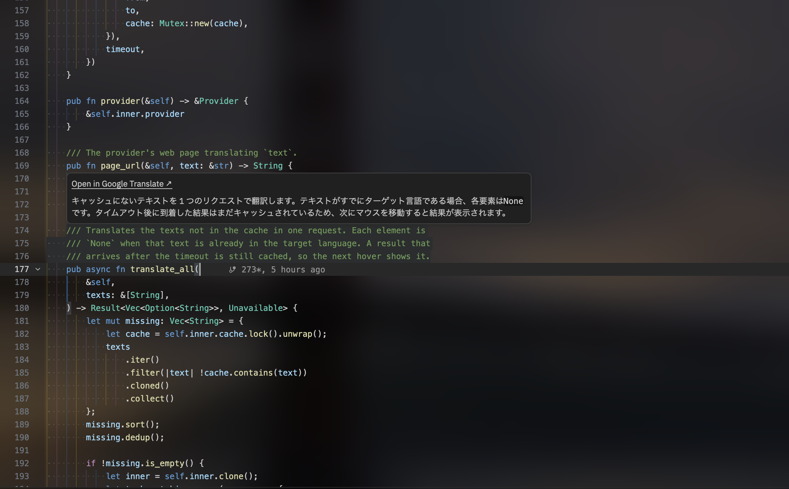
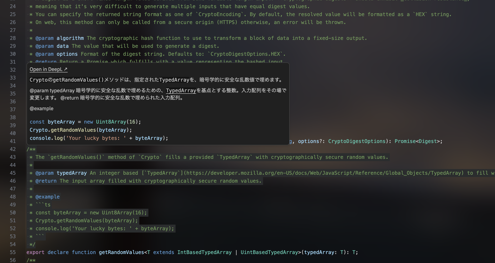

# Comment Translate for Zed

[](https://github.com/273Do/zed-comment-translator/releases/latest)
[](../LICENSE)

[English](../README.md) | 日本語

[Zed](https://zed.dev/) でコメントにホバーすると、
[Google 翻訳](https://translate.google.com/) または [DeepL](https://www.deepl.com/)
で翻訳して表示する拡張機能。60 以上の言語で同じように使える。




## 機能

- カーソル下のコメントを翻訳する。行コメント (`//`・`#`・`--` など)、ブロックコメント (`/* */`・`<!-- -->` など)、ドキュメントコメント (`///`・`/** */` など) に対応。
- Rust・Python・JavaScript/TypeScript・Go・C/C++・Java・Ruby・Lua・Haskell・HTML など多くの言語に対応 ([extension.toml](../extension.toml) の `languages` を参照)。
- 連続する行コメントはまとめて翻訳し、文字列をコメントと誤認しない。
- コメント中のコードブロックとインラインコードはそのまま残す。
- Google Cloud Translation API と DeepL (Free / Pro キー) に対応。
- 翻訳結果を原文をキーにしてファイルにキャッシュする。キャッシュ済みの翻訳はすぐに表示され、オフライン時や再起動後にも使える。
- 翻訳できないとき (オフライン・失敗・翻訳中) は理由を表示する。
- 原文と言語を入力済みの翻訳サービスのページへリンクする。
- 言語サーバーは自動でダウンロードされる。macOS・Linux・Windows 向けのビルド済みバイナリを用意している。

言語の標準ライブラリなど、ライブラリのドキュメントを読みたいときは、**Go to Definition** (cmd/ctrl+クリック) でソースに移動し、そこでコメントにホバーする。

## 仕組み

```text
Zed ──stdio──▶ comment-translate-server   (rust-analyzer や pyright などと並べて動く)
                 └ コメントへのホバーに答える
```

Zed 拡張 (WASM) が `comment-translate-server` (ネイティブ) を用意し、各言語の通常のサーバーと並べて、単独の言語サーバーとして起動する。開いているファイルの内容を追跡し、ホバーにだけ答える。カーソルがコメント上にあれば、その翻訳を返す。Zed はこれを他のサーバーのホバーとまとめて表示する。他のサーバーのホバーには手を加えない。

## インストール

1. Zed の **Extensions** を開く。
2. **Comment Translate** を検索する。
3. **Install** を選ぶ。

> [!NOTE]
> 公開されるまでは、ソースからインストールする。[開発](#開発) を参照。

あとは Google か DeepL の API キーを設定する ([API キー](#api-キー) を参照)。これで対応するすべての言語でコメントが翻訳される。キーが無いと、ホバーにキーが必要な旨が表示される。

言語サーバーは `lsp.comment-translate.binary.path` → シェルの `PATH` → GitHub Releases からの自動ダウンロードの順に探す。

## 設定

設定はすべて省略できる。

```jsonc
{
  "lsp": {
    "comment-translate": {
      "settings": {
        "provider": "google",
        "google_api_key": "",
        "deepl_api_key": "",
        "target_language": "ja",
        "source_language": "auto",
        "timeout_ms": 1500,
        "persist_cache": true,
      },
    },
  },
}
```

| キー              | 既定値     | 説明                                                                                                                                                                                             |
| ----------------- | ---------- | ------------------------------------------------------------------------------------------------------------------------------------------------------------------------------------------------ |
| `provider`        | `"google"` | `"google"` または `"deepl"`                                                                                                                                                                      |
| `google_api_key`  | なし       | Google Cloud Translation API のキー。環境変数 `COMMENT_TRANSLATE_GOOGLE_API_KEY` でも指定できる。未設定なら DeepL を使う                                                                        |
| `deepl_api_key`   | なし       | [DeepL の API キー](https://www.deepl.com/ja/pro-api)。`:fx` で終わる Free キーは Free 用の API を使う。環境変数 `DEEPL_API_KEY` でも指定できる。未設定なら Google を使う                       |
| `target_language` | `"ja"`     | 翻訳先の言語                                                                                                                                                                                     |
| `source_language` | `"auto"`   | 翻訳元の言語                                                                                                                                                                                     |
| `timeout_ms`      | `1500`     | 翻訳を待つ時間。超えたらその旨を表示し、訳文はキャッシュして次回のホバーで表示する                                                                                                               |
| `persist_cache`   | `true`     | 翻訳のキャッシュをファイルに残す。`false` ならメモリ上だけに持ち、Zed を終了すると消える (起動時に残っているキャッシュファイルも削除する)                                                        |

設定を変えたら `editor: restart language server` で反映する。

### API キー

どちらか一方のキーを設定する。両方あるときは `provider` で選んだ方を使う。

**Google Cloud Translation** (月 50 万文字まで無料、超えると有料):

1. [Google Cloud コンソール](https://console.cloud.google.com/) でプロジェクトを作り、請求先アカウントを紐付ける。無料枠の範囲内でも必要。
2. [Cloud Translation API](https://console.cloud.google.com/apis/library/translate.googleapis.com) を有効にする。
3. **API とサービス → 認証情報** で **認証情報を作成 → API キー** を選び、キーを Cloud Translation API だけに制限する。

**DeepL**: [DeepL API](https://www.deepl.com/ja/pro-api) に登録し (Free プランは月 50 万文字まで)、アカウントページからキーをコピーする。

> [!IMPORTANT]
> API キーはパスワードと同じように扱うこと。Google のキーが漏れると課金される可能性がある。リポジトリにはコミットしないこと。キーは環境変数で言語サーバーに渡すので、プロセス一覧には表示されない。

### キャッシュ

翻訳サービスと言語の組み合わせごとのファイル (例: `google-auto-ja.jsonl`) に保存される。

| OS      | 保存先                                                                          |
| ------- | ------------------------------------------------------------------------------- |
| macOS   | `~/Library/Caches/comment-translate/`                                           |
| Linux   | `$XDG_CACHE_HOME/comment-translate/` (未設定なら `~/.cache/comment-translate/`) |
| Windows | `%LOCALAPPDATA%\comment-translate\`                                             |

環境変数 `COMMENT_TRANSLATE_CACHE_DIR` で保存先を変更できる。ファイルを消すとキャッシュがクリアされる。

## プライバシー

> [!WARNING]
> ホバーしたコメントは、選んだ翻訳サービス (Google または DeepL) に送信される。それ以外のコードは送信されず、キャッシュ済みのコメントも再送信されない。コメントを外部に送ってはいけないコードでは使わないこと。

## 開発

[Rust](https://rustup.rs/) が必要。

1. 言語サーバーをインストールする: `cargo install --path server`
2. Zed で `zed: install dev extension` を実行し、このリポジトリを選ぶ。

コントリビューションやバグ報告を歓迎しています。

## ライセンス

[MIT License](../LICENSE) で公開している。
